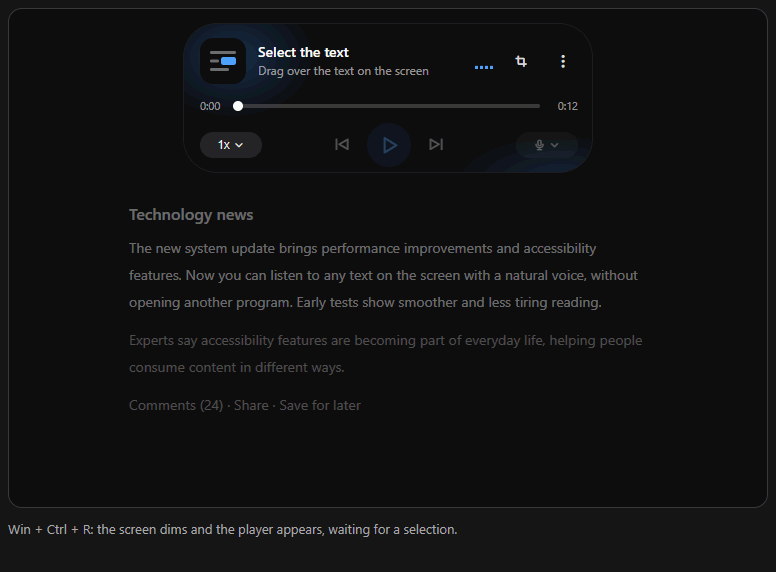

<p align="center">
  
</p>

<h1 align="center">SnapVox</h1>

<p align="center">
  Select any text on your screen and listen to it in a natural voice.
</p>

<p align="center">
  
</p>

---

## What it is

SnapVox lives in the Windows tray. Press **Win + Ctrl + R**, drag over any text anywhere on the screen
(website, PDF, image, video, game…) and it reads it aloud, highlighting each word as it speaks.

- **Works on anything on screen**: the text is recognized from the image (Windows OCR).
- **Detects the language by itself** and picks the right voice.
- **Natural voices**: Microsoft neural voices (Edge) by default; **Piper** (runs on your PC, offline) and the
  Windows voice as automatic fallbacks.
- **Dynamic Island–style player**: pause, previous/next word, 0.5x–2x speed (changes instantly),
  voice and language switching, at the top or on the sides of the screen.
- **Save as MP3** what was read.
- **Lightweight**: idles in the tray without using CPU; compiled to native code.
- UI in **English** or **Portuguese**, following the Windows language.

Want to click around? Download [`docs/demo.html`](docs/demo.html) and open it in your browser for an interactive version.

## Shortcuts

| Key | What it does |
|---|---|
| **Win + Ctrl + R** | Opens the selection (again, at any time) |
| Drag on the screen | Selects the text (dragging again replaces the selection) |
| Mouse wheel | Scrolls the page underneath |
| **Space** | Pause / resume |
| **← / →** | Previous / next word |
| **↑ / ↓** | Faster / slower |
| **Esc** | Closes |

## Install

Download from the [Releases](https://github.com/SamadhyManfro/SnapVox/releases) page:

- **Installer** (`SnapVox-Setup-x.y.z.exe`): no administrator rights needed, updates itself.
- **Portable** (`SnapVox-Portable-x.y.z.exe`): nothing to install, just double-click it. It keeps its settings and
  voices in a `SnapVox Data` folder next to the exe, so it's best placed in its own folder or on a USB drive.

Then press **Win + Ctrl + R**.

Requires **Windows 10 2004** or newer (64-bit). When you pick a voice for another language, SnapVox installs
that language's text recognition and Windows voice (Windows asks for permission).

> **Smart App Control note**: until SnapVox is digitally signed, Windows may block the installer on PCs with
> Smart App Control turned on.

## Privacy

- The selected text is recognized **on your PC** (Windows OCR).
- With the **Microsoft (Edge) voices**, the text is sent to Microsoft's speech service to generate the audio.
  The **Piper** voices and the **Windows voice** run entirely on your PC.
- SnapVox checks GitHub for new versions (you can turn this off in Settings).

## Build

Requires the **.NET 10 SDK**, the **Visual Studio Build Tools** with the C++ workload (for native AOT)
and **Inno Setup 6**.

```powershell
.\build.ps1                        # produces the installer and the portable exe in artifacts\
dotnet run --project src/SnapVox   # run in development mode
```

Headless test tools (see `src/SnapVox/Program.cs`): `--ocr-test`, `--tts-test`, `--mp3-test`,
`--render-island`, `--render-settings`, `--capture-test`, `--detect`.

## Suggestions and issues

Use **⋮ → Send a suggestion** in the app, or open an [issue](https://github.com/SamadhyManfro/SnapVox/issues).

## License and credits

SnapVox is free software under the **GPL-3.0** (see [LICENSE](LICENSE)).

- [Avalonia UI](https://avaloniaui.net/) — MIT
- [sherpa-onnx](https://github.com/k2-fsa/sherpa-onnx) — Apache-2.0 · [Piper](https://github.com/rhasspy/piper) voices
  (each voice has its own license) · [espeak-ng](https://github.com/espeak-ng/espeak-ng) — GPL-3.0
- Microsoft voice protocol based on [edge-tts](https://github.com/rany2/edge-tts) — LGPL-3.0
  (in `src/SnapVox.EdgeTts`, under the same license). Edge's "Read aloud" service is not an official API and may
  change; that's why SnapVox automatically falls back to Piper or the Windows voice if it fails.
